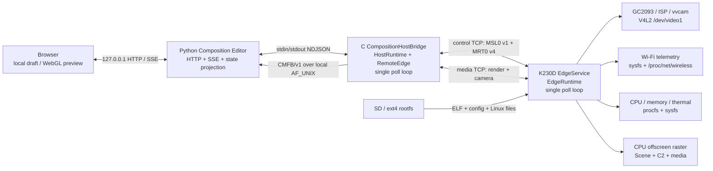

# Meiso Glass 系统与产品基线

> `ENGINEERING MAP / NON-NORMATIVE`，更新于2026-09-08。职责和语义仍由
> [规范入口](index.md)及已选择的[Display Ingress Profile](../profiles/display_ingress/README.md)拥有。
> 已验代码配对、构建安装与应用 SDK 使用入口统一见[Host→Edge 快速开始](host-edge-quickstart.md)。

## 产品要完成什么

Host运行应用、交付内容并理解Edge真实状态；Edge在K230D **128 MiB**设备上完成解码、
本地叠加与显示。三种模式可组合，数据来源均为Host：

| 模式 | 内容在哪里渲染 | 初步基线 |
| --- | --- | --- |
| 世界空间简单3D / 6DoF | Edge，Host提供对象数据 | 缺IMU，按产品决定延后。当前不宣称实机姿态跟踪。 |
| 应用视频，包括OpenXR应用画面 | Host渲染/压缩，Edge解码显示 | 1280×720合并视频已通过实际两端；compositor及API逐眼源均已接通。API源每眼姿态/FOV及可转换的目标时间随对应帧到Edge；源Runtime仍负责定位和输入。 |
| 屏幕2D消息、框、字幕 | Edge，Host提供计划 | 独立纯消息及视频并发均已通过，支持单区域矩形/样式、一行有限ASCII/CJK文字、双眼重复、desired/actual与实际呈现回执；多区域和完整排版未完成。 |

当前最短使用链是：独立应用 → Looking Glass本机IPC/HostRuntime → Meiso SDK的能力、
状态与压缩媒体交付 → K230D MVX解码/DRM视频和2D叠加 → Host取得实际呈现与释放反馈。
应用退出会隐藏2D并清屏；断开的旧应用会收到失败，新连接使用新会话。

720p是初步产品基线。所选Profile把同一解码buffer的两个半帧放入各自物理眼区，
无需额外全帧复制；1920×1080输出时，两份640×720画面分别居中。输出参数与输入尺寸分开，
该布局尚未做全屏缩放或光学校准。更高分辨率的性能研究不阻挡这条完整链先交付。

## 职责与仓库边界

| 职责 | 归属与入口 |
| --- | --- |
| 连接身份、Session、State/Stream/Action/Blob传输语义 | Meiso Core：`include/meiso/core/`、`src/core/`。 |
| 能力/路由协商、desired/actual、资源与媒体契约、Host与Edge框架 | Meiso SDK：`include/meiso/runtime/`、`profiles/`、`integrations/`。代码中Runtime仍指这一协议运行库，不代表应用兼容层。 |
| 本机应用API/IPC、组合与平台输入、编码及应用生命周期 | Looking Glass `sdc/`；[Meiso Host应用入口](https://github.com/shisuiki/looking_glass/blob/v0.1.0-alpha.1/sdc/integrations/meiso/presentation_sink/README.md)。它通过公开SDK契约对接设备。 |
| K230D驱动适配、有限缓冲、解码/显示及真实反馈 | Meiso `targets/k230d-linux/`；[构建、安装与BusyBox启动](../targets/k230d-linux/README.md#连续视频与原生2d构建安装和启动)。 |

保留两个产品仓：共用Meiso SDK与Looking Glass Host应用集成。H2E曾是Meiso的工作树，
其已验代码已进入主分支，工作树已清理；实验记录仓保存协作/板级证据，不是第三套SDK。
另一个graphics-lanes开发工作树及工作中修改不因这次整合自动成为已验产品基线。

## 已验证的使用边界

运行组件分别是Meiso的 `K230dVideoRuntime` 和Looking Glass的 `MeisoHostRuntime`；
Host客户端SDK已可安装/迁移，仓外应用用find_package消费消息和视频接口并通过实机验证。
Host复用systemd用户服务，Edge复用BusyBox init和单子进程重连器；PeerID及网络地址由
部署配置提供。两侧服务已通过各自设备普通重启、控制连接失联后重新接入的验证；
恢复后新启动应用的视频、消息和退出清屏通过，不表示先前应用会自动重启或重放。

当前已接受的部署链路是Host USB → 台架路由 → Edge Wi-Fi；中转配置已持久化，
直接双设备Wi-Fi仍是后续改进。Profile的身份声明不等于密码学认证。
完整XR设备兼容、Edge实机姿态反馈/微调、光学标定、安全通信和正式发行仍有缺口。
已传递源渲染姿态不表示已有实机跟踪闭环；初步链路成立不等于完整产品已上线。

默认构建已隔离旧Composition应用栈；它仅在 `MEISO_BUILD_LEGACY_COMPOSITION=ON` 时生成。
当前相机链使用的CameraMedia schema/profile/media/POSIX依赖保留，scene与视频后端不受该开关控制。
组件与保留清单见[SDK构建边界](sdk-guide.md#3-cmake-package-与组件)；下方仍是历史记录。

历史 Composition 工程记录（截至2026-09-02，包含当时的资源与架构问题）

下文按原日期和源码基线保留；其中“当前”“尚未显示”等表述只针对当时的Composition路径，
不覆盖上面的Display Ingress与Looking Glass应用基线。历史实验数据继续有效，不重复验证其真实性。

> 状态：`ENGINEERING MAP / NON-NORMATIVE`。本文帮助阅读和调试当前系统，不创建第二套产品语义。
> 产品语义仍以[系统](system.md)、[Resource](resource.md)、[Runtime](runtime.md)、
> [Link](link.md)和[Composition](composition.md)五份规范为准。
>
> 源码基线：commit `93f6c68b21483487684ed36fc9a88328c0ca4b64`，tree
> `8eca2d47e9beae8e42b24935cd905a540af81a10`。板端动态数字只表示所注保留证据时间点，
> 不是 2026-09-02 的实时探针。
> 当前工作树另有 6 文件的未提交 Host lifecycle 止血实验；除“已知架构债”外，本文不把它当产品事实。

## 先读这十条

1. 系统只有两个公开协议角色：`Host` 提交 intent/内容并消费结果，`Edge` 拥有设备和最终 actual truth。
   角色不等于进程、CPU 或板卡；当前 K230D 整板是一个 Edge。
2. Browser 不是 Meiso 协议端。它只连接本机 Composition Editor；真正的协议端是 C HostBridge 与 K230D EdgeRuntime。
3. Host 与 Edge 没有共享内存。同步完全依靠消息、owner/version、generation、epoch、nonce 和显式 borrow lifetime。
4. K230D 有 **128 MiB LPDDR4**；**32 MiB 是 Linux CMA 池**，不是整机内存。
5. CMA 是 Linux `MemTotal` 的一部分。普通 movable page 可以借住其中；低 `CmaFree` 不等于泄漏或必然分配失败。
6. Portable Core/Runtime/Composition 与两端 C Runtime 都是 caller-owned arena、单线程、无内部锁；复杂并发集中在 Python Editor 外壳。
7. `thermal` 是 SoC 温度遥测，不是“热力学计算”。额外 thermal worker 只为隔离可能阻塞的 sysfs 读取。
8. `HTTP 202`、native receipt、wire delivery、Edge actual applied、Stream/media 出数是五个不同阶段，不能互相代替。
9. 当前只证明 CPU offscreen render 和 Host preview；没有物理 display/scanout、fence、vblank、TLS、发现或 Link heartbeat。
10. 当前反复出现的深层缺陷主要是 **Host supervisor 的终态所有权和状态建模**，不是已观测到的网络、CMA 或板端算力不足。

## 1. 一张图看完系统

另有 SSH、串口和外部 runner 用于部署、取证、启停进程；它们是维护面，不是 Meiso Link，也不提供业务 identity。

### 三种通信不能混为一谈

| 边界 | 载体 | 语义 |
|---|---|---|
| Browser ↔ Python | loopback HTTP JSON、SSE、CMFB HTTP response | 本地编辑、投影和预览；不是 wire truth |
| Python ↔ C Host child | stdin/stdout strict NDJSON；frame 用 AF_UNIX socketpair 的 CMFB/v1 | machine-local process protocol；不是 Meiso wire |
| C Host ↔ K230D Edge | 两条 numeric direct-IP plain TCP | control 承载 MSL0/MRT0；media 承载 Profile OPEN/BIND/FRAME |

## 2. 分层、对象和代码边界

| 层 | 拥有什么 | 明确不拥有什么 | 主要位置 |
|---|---|---|---|
| Core | identity、Session、`State/Stream/Action/Blob` primitive | Profile、socket、camera、HTTP | [`include/meiso/core/`](../include/meiso/core/)、[`src/core/`](../src/core/) |
| Runtime | catalog、endpoint/route、desired/actual carriage、Blob transfer、scheduler | 平台 I/O 和设备特例 | [`include/meiso/runtime/`](../include/meiso/runtime/)、[`src/runtime/`](../src/runtime/) |
| Composition Profile | exact `COMPOSE_/_PROFILE:v1`、6 endpoint/18 route、schema/capability/media binding | 任意动态 graph 或降级协商 | [`profiles/composition/`](../profiles/composition/) |
| Composition domain | Blob-visible SceneStore、Coordinator/C2、CPU renderer | thread、socket、heap、physical display | [`composition/`](../composition/) |
| ControlSession | 一个 arena 内的 Session、TCP adapter、Runtime、Scheduler、20 个 fixed source | fd ownership、隐藏 poll loop | [`integrations/composition/`](../integrations/composition/) |
| HostRuntime/RemoteEdge | 6 desired publisher、6 actual replica、3 inline Stream、mesh transfer、最多 4 个一次性 media slot | 应用 draft、Browser、socket ownership | [`integrations/host/`](../integrations/host/) |
| C HostBridge application | control/media socket、Host arena、stdin/stdout NDJSON、frame-fd | 浏览器 UI、设备驱动 | [`applications/host/`](../applications/host/) |
| K230D EdgeRuntime | 6 desired replica、6 actual publisher、telemetry、Blob/Scene/C2/render/camera/media | listener/process policy | [`targets/k230d-linux/composition_edge_runtime.c`](../targets/k230d-linux/composition_edge_runtime.c) |
| K230D EdgeService | listeners、accepted fd、Runtime arena、signal/cleanup、thermal worker | Meiso 产品语义 | [`targets/k230d-linux/composition_edge_service_run.c`](../targets/k230d-linux/composition_edge_service_run.c) |
| Python Editor | local draft、HTTP/SSE、child supervision、sanitized native projection、latest frame cache | MSL0/MRT0 编解码和 Edge truth | [`devtools/web/composition_editor/`](../devtools/web/composition_editor/) |

关键所有权：应用层拥有 socket 和进程；C library 只借用 fd。每个 portable handle 都在 caller arena 中，必须由一个 owner 串行调用。`RemoteEdge` 借用 `HostRuntime`；camera adapter 才真正拥有 `/dev/video1` fd 和 4 个 MMAP，直到 stop。

## 3. 为什么有这么多线程；thermal 是什么

### 当前线程拓扑

| 进程 | 正常线程 | 原因 |
|---|---:|---|
| K230D EdgeService | 1 foreground + 按需 1 个短命 thermal worker | 主线程用 `poll()` 驱动全部业务；worker 隔离可能阻塞的温度文件读取 |
| C HostBridge child | 1 | 一个 `poll()` 同时驱动 stdin、control、media 和 frame output |
| Python NativeBridge | 每个 child 固定 5 个 daemon worker | writer、stdout、stderr、frame、process-wait 分离 |
| Python Editor state | 0 或 1 个 reconnect worker | fresh child 重建/backoff |
| Python HTTP server | 每个连接一个线程 | `ThreadingHTTPServer`；SSE 长连接也占线程 |

Core、Runtime、Session、Scene、Coordinator、renderer、camera state machine **自己都不创建线程**。

### thermal 不是“热力学引擎”

`thermal` 这里只表示 SoC junction temperature telemetry：读取
`/sys/class/thermal/thermal_zone0/type` 和 `temp`，并要求 type 为 `canaan_thermal_zone`。
sysfs 读取可能阻塞，所以 Edge 把一次有界读取交给 worker；worker只收到 value-copy request，结果通过
value-copy + `atomic_bool` 交还，不保存 Runtime 指针；当前budget为100 ms。它不是持续计算、风扇控制或能耗模拟。

### 多线程是否必要

- Edge 和 C Host 的单 reactor 已证明业务本身不需要很多线程。
- Python 把每种阻塞 I/O 放一个线程，早期实现简单，但让 raw terminal、stdout EOF、stderr、frame EOF、child exit、close 和 reconnect 都可能竞争“谁宣布终态、谁清理”。
- 锁只能串行某一段 callback，不能自动建立唯一资源 owner。近期反复修 race，是状态/所有权模型不足，不是少补一个 `join()`。
- 宏观整改方向应是一个 supervisor actor/reducer 管一个 immutable Session：
  `DISABLED → SPAWNING → AWAITING_SERVICE_READY → BOOTSTRAPPING → LIVE → RETIRING → BACKOFF/BLOCKED/CLOSED`。
  `service.ready` 之前不能把 `Popen` 成功称为重连成功；backoff 只能在达到健康里程碑后重置。

## 4. K230D 内存：128 MiB、32 MiB CMA 到底是什么

### 物理和 Linux 账本

| 项目 | 数值 | 解释 |
|---|---:|---|
| 物理 LPDDR4 | 128 MiB / 131,072 KiB | K230D 整机 DRAM |
| NuttX/CPU0 reserved-memory | 16 MiB | `0x07000000..0x07ffffff`，`no-map`；不属于 Linux 应用 |
| Linux `MemTotal` | 72,708 KiB | 2026-08-24 板端实测；已经扣除内核不可用保留 |
| Linux CMA | 32,768 KiB | `CONFIG_CMA_SIZE_MBYTES=32`；是 `MemTotal` 内的一块，不是额外内存 |
| 启动日志 | `38968K/131072K available` | 同时报告 `59336K reserved`、`32768K cma-reserved`；不能用三项简单相减重算 MemTotal |
| v11 运行前/后 `MemAvailable` | 29,928 / 29,540 KiB | 2026-09-01；未见持续增长或分配失败，且清理ledger闭合 |
| v11 运行前/后 `CmaFree` | 11,132 / 13,544 KiB | 运行结束反而更高；`cma_alloc_fail=0` |

`CmaFree` 只表示 CMA 区中“此刻完全空闲”的页。普通 file/anon movable page 可以借住 CMA，在 DMA 连续申请时再迁走；因此它不等于总空闲、不等于最大连续块，也不等于 vvcam 使用量。

历史实机在 `CmaFree=3,268 KiB` 时相机仍一次成功；combined 最低 `360 KiB` 也成功并在退出后回到约 15,000 KiB。反过来，大请求即使聚合空闲字节够，也可能因连续 extent、分配顺序或 pinned page 失败。正确 admission 同时看：

- 精确请求大小与 request-sized extent；
- `cma_alloc_fail`/内核 allocation failure；
- `MemAvailable`；
- `/proc/vsi/vb0` 的 vvcam `Used`；
- ISP owner；
- 退出后 camera/media/映射/进程是否归零。

2026-08-31同板fresh-boot的一次只读PFN分类把32 MiB CMA分成约18,012 KiB file/other LRU、
6,824 KiB anon LRU、6,456 KiB buddy free 和 1,476 KiB 其他/未分类；也就是至少约
24.8 MiB 是普通可迁移/可回收页，不是常驻 DMA buffer。当时 vvcam `Used=0`、CMA
allocation failure 也为 0。这解释了为什么“idle 时 `CmaFree` 低”不能直接叫相机泄漏。

### Edge 用户态 arena 的分配

EdgeService 启动时一次 `posix_memalign`，将主要 Runtime arena 整体预留和清零；内部组件不用无界堆。
下表是当前源码在 macOS LP64 ABI 上的精确 layout 参考。RISC-V LP64D 的最终 target snapshot 尚未封存，故不能把总数冒充板端实测。

| 组成 | 参考字节 | 用途 |
|---|---:|---|
| Edge arena 总计 | 10,131,688 | 主要用户态业务状态和 bounded buffer |
| ControlSession | 557,768 | Session、Runtime、Scheduler、TX/RX scratch |
| BlobStore | 4,720,304 | 16 published slot、1 staging、单 Blob ≤256 KiB |
| SceneStore | 31,656 | 两个 world slot、candidate/active refs |
| Coordinator | 1,520 | plan/token/frame-boundary activation |
| CPU renderer | 1,261,496 | 两套 color+depth target、2 jobs、result scratch |
| Camera adapter object | 552 | fd/mapping ledger；不含 driver buffer payload |
| Core State arenas | 6,944 | desired/actual bounded state |
| Core Stream arenas | 34,456 | Wi-Fi、device、RenderResult rings |
| 4 个 media slot | 3,478,464 | 每个 869,616；重连代际预留，不是 4 条并行连接 |
| struct/alignment 余量 | 38,528 | runtime struct 与布局对齐 |

Arena 不等于进程全部 RSS：libc、共享库、线程栈、内核 socket buffer、ISP 进程和 driver/CMA 都在账外。

## 5. Buffer、SD、page cache 与 swap

### 主要 buffer

| Buffer | 数量/大小 | 所在内存 | 生命周期 |
|---|---:|---|---|
| CPU render color | 2 × 307,200 B | Edge 普通 RAM arena | 两套 320×240 RGBA8888 target |
| CPU render depth | 2 × 307,200 B | Edge 普通 RAM arena | 两套 320×240 depth32 target |
| renderer 像素主体 | 1,228,800 B | Edge 普通 RAM arena | 固定预留，不是显存/CMA |
| media slot | 4 × 869,616 B | Edge 普通 RAM arena | 当前只允许一个 active connection；slot 终态后不复活 |
| V4L2 MMAP | 4 × 115,200 B = 460,800 B | driver/DMA buffer 映射到 Edge | DQBUF 借用一帧，复制进 media slot 后立即 QBUF；stop 后全部 unmap |
| 相机 driver CMA 实测 | 8,192 + 4,149,248 + 1,040,384 B ≈ 4.96 MiB | CMA/driver | 2026-08-31同板camera run的三笔分配，退出有对应release |
| Host frame cache | render 最新 1 帧 + camera 最新 1 帧 | Host Python RAM，不占 K230D | 完整 CMFB 才替换；不保存 partial |
| Editor event ring | 默认 256 个完整 snapshot | Host Python RAM | 每事件深拷贝；SSE 取批时再复制 |

ISP 常驻进程的精确 RSS/CMA、socket buffer 和 RISC-V Edge arena target 值尚未封存，不能从上表倒推。

### SD 和文件系统

当前卡约 59.5 GiB，但固定 GPT 只使用约 2.5 GiB：

| 区域 | 起点 | 分配范围 | 当前用途 |
|---|---:|---:|---|
| raw boot chain | 1 MiB | 位于磁盘前 4 MiB | SPL/U-Boot/env；不是GPT分区 |
| `boot_a` / p1 | 32 MiB | 96 MiB | A 启动 |
| `boot_b` / p2 | 128 MiB | 96 MiB | B 启动 |
| `rootfs_a` / p3 | 256 MiB | 768 MiB | 当前 `/dev/root`、ext4 rw |
| `rootfs_b` / p4 | 1,024 MiB | 768 MiB | B 根文件系统 |
| `data` / p5 | 1,792 MiB | 768 MiB | 更新/历史/分析数据 |

2026-08-24 保留的 `df`：`/dev/root` 文件系统 499,284 KiB，已用 235,880 KiB，可用 226,708 KiB，51%；p3 虽为 768 MiB，seed ext4 尚未扩满。`/tmp` 是 RAM-backed tmpfs（上限 36,352 KiB，当时仅 52 KiB），不是 SD。剩余约 57 GiB 不能称为已分区或可用。2026-09-02 的实时使用量未采集，因此不能把历史 51% 写成“当前”。

### “硬盘换内存”到底发生什么

- 普通文件从 SD 读入 Linux page cache；内存紧张时干净 file page 可丢弃，稍后从 SD 重读。
- 文件写入先进入 page cache，再由内核回写 ext4/SD。
- 匿名 movable page 可以在 RAM 内迁移，包括迁出 CMA；这不是 swap。
- 产品没有把 arena、Scene、Blob 或帧自动溢写到 SD 的逻辑。
- 当前 GPT 没有 swap 分区，provisioning/fstab 也未发现 swapfile、zram 或 zswap；但保留证据没有直接读取 `/proc/swaps` 和 `SwapTotal`，所以准确结论是：**没有已知 swap 路径，实时 `SwapTotal=0` 尚未证明**。
- 即使新增 SD swap，也不能解决 CMA 连续性或 pinned DMA page，还会增加不可控延迟和闪存磨损。

## 6. 当前长寿命状态机、存放位置和同步方式

这里的“全部”指当前产品主路径中会跨一次函数调用存活的状态机；不枚举每个 parser 返回码和测试夹具状态。Core Action caller/executor/dedup 已实现，但当前 Composition 6/18 graph 没有 Action route，因此不列入这条运行主链。

| 状态机/对象 | 主要状态或 key | 存放位置 | owner 与同步 |
|---|---|---|---|
| Core Session | `NEW/HANDSHAKING/READY/CLOSING/CLOSED/FAILED`；内部 OPEN/ACCEPT/CONFIRM/READY phase | 两端 ControlSession arena | 各端单 owner；TCP message + identity/nonce/SessionId |
| Core State publisher/replica | owner/version、pending/accepted、delivery generation | Runtime 内各 route arena | 单 writer；offer/commit/accept |
| 每路 desired/actual production | `STOPPED/STARTING/RUNNING/DEGRADED/STOPPING/FAILED`；apply=`NONE/PENDING/APPLIED/REJECTED/FAILED`；availability=`PRESENT/ABSENT/UNAVAILABLE` | Host/Edge Runtime channel record | desired由Host写，actual由Edge写；observed/applied desired ref关联 |
| Core Stream | producer、epoch、sequence、bounded history | Runtime arena | producer 单调 sequence；consumer cursor |
| Core Blob | published slot、staging、BEGIN/CHUNK/COMMIT/ABORT/result | Runtime/BlobStore arena | ContentId/hash + current control scope |
| Runtime catalog | staged/pending/active generation、endpoint incarnation、route | Runtime arena | atomic catalog accept/rebind；不接受子集 |
| Scheduler | `CONFIGURING/REBIND_REQUIRED/READY/DATA_ROUND/SESSION_TERMINAL` | ControlSession arena | 单线程 round-robin + RX obligation |
| Composition ControlSession | `HANDSHAKE/CATALOG/REBIND/READY/RX_OBLIGATION/TERMINAL` | Host/Edge Runtime arena | 唯一 pump owner；borrow fd |
| HostRuntime | `HANDSHAKE/CATALOG/REBIND/READY/TERMINAL`；6 desired/actual、inline/media ledger | Host C heap arena | C Host poll loop串行 |
| RemoteEdge handle | `BOOTSTRAPPING/READY/TERMINAL`、catalog continuity、typed views | 借用 HostRuntime | 旧 Session/backend replacement 后永久 stale |
| K230 EdgeRuntime | `HANDSHAKE/CATALOG/REBIND/READY/TERMINAL`；全部设备/Composition truth | EdgeService 的大 arena | Edge foreground poll loop串行 |
| MediaTransport | Host `OPEN_PENDING/WAIT_BIND/ACTIVE`；Edge `WAIT_OPEN/BINDING/ACTIVE`；`TERMINAL` | 每个 media slot 的一次性 arena | Session/catalog/route/production/media epoch/nonce exact bind |
| SceneStore | control scope、candidate/active world、world generation、Blob visibility | Edge arena | prepare 后在明确边界 activate |
| Coordinator/C2 | candidate/active plan、prepared token、activation pending | Edge arena | Host token echo + frame boundary |
| CPU renderer | current scope、2-job queue、complete target/result | Edge arena | 单线程 submit/render/retire |
| Camera adapter | `STOPPED/RUNNING/TERMINAL`、fd、4 mappings、queued、borrow、cleanup error | Edge arena + kernel fd/MMAP | Edge loop唯一 owner；一帧 borrow 必须 exact QBUF release |
| EdgeService process | listeners、accepted fds、stop flag、thermal request、shutdown ledger | process struct + kernel | foreground loop；signal handler只置 flag；thermal只传 value-copy |
| C HostBridge process | fds、arenas、stdin buffer、object map、frame output、close flags | process heap/stack + kernel | 单个 C poll loop |
| Python NativeBridge | child、outbound 64、requests 64、latest 2 frames、worker/terminal flags | Python heap；`Condition` | 5 workers协调；不是协议 truth |
| CompositionEditorState | browser draft/revision、snapshot、256-event ring、bridge/spec/generation/reconnect/refresh | Python heap；`Condition` | HTTP线程与reconnect线程；generation过滤旧 child |
| Linux driver/ISP | V4L2 queue、DMA/CMA、sensor/ISP内部状态 | kernel/独立 `isp_media_server` | 不由 Meiso Runtime启动或监督 |

上表状态全部是易失 RAM/kernel state；产品没有数据库或状态日志恢复。重启、进程替换或
Session/catalog discontinuity 都要求 fresh identity/arena/epoch，不能从 SD 把旧 handle 或队列恢复回来。

### 真值层级

`Edge actual/Stream/media` 是设备真值；Host replica 是带 Session/catalog freshness 的副本；C Host NDJSON 是本机 typed projection；Python snapshot/SSE 是 sanitized cache；Browser draft 是候选意图。越向右越不能反向覆盖左侧真值。

## 7. 从连接、同步到断开：一条完整叙述

### 7.1 进程与连接建立

1. EdgeService 读取私有配置，创建 control 和 media 两个 `AF_INET/SOCK_STREAM` listener；backlog 都是 1。control 接受一个连接后会关闭 control listener，media listener继续接候选连接。
2. Python Editor 显式启用 native backend，创建 NativeBridge；NativeBridge 启动 C Host child，并建立 stdin/stdout/stderr pipe 与一对本机 CMFB socket。
3. C Host 读取独立配置，以 numeric IP 主动连接 control TCP，分配 HostRuntime/RemoteEdge arena，随后输出 `service.ready`。locator 不是 peer identity。

### 7.2 Core Session 与 catalog

4. Host Session 发送 `OPEN`；Edge对peer、incarnation、nonce、协议/Profile做exact校验，对双方limits做合法性检查并逐字段取最小值后发`ACCEPT`；Host回`CONFIRM`；Edge回`READY`。此时仅Core Session READY。
5. Edge 再发送固定 `COMPOSE_/_PROFILE:v1` 的 6 endpoint/18 route catalog。Host 独立构建期望值，逐 identity、incarnation、schema、capability、route、owner 和 delivery exact equality；不一致即 fail closed。
6. catalog 接受后，两端 Runtime/Scheduler 绑定同一 generation 的 18 个 RouteKey，ControlSession 才进入 READY。

### 7.3 intent、desired、actual 和内容同步

7. Browser POST 先原子更新 Python local draft/revision，并得到 HTTP 202。Python 给每条 native 子命令 request id，写入 C child。202 只表示本地接受/排队。
8. C Host 将命令转为 HostRuntime desired State。六组 Host-owned desired 是 Wi-Fi、Presentation、Scene、Device、RenderMedia、CameraMedia。
9. 每路同步都是：`Host desired offer → Edge replica commit/accept → Edge admission/apply → Edge-owned actual offer → Host replica commit/accept`。只有 fresh actual 才说明 apply/availability/effective/production；native receipt 仍不是 apply。
10. Mesh 通过 Blob `BEGIN → READY → CHUNK* → COMMIT → PUBLISHED` 进入 Edge arena，不写 SD。SceneStore 只引用当前 scope 已完整校验的 ContentId。
11. Edge 准备 candidate world 和 presentation plan，发布 prepared token；Host 在更高 desired version 回显 token；Coordinator 在 frame boundary 原子激活 plan/world，并退休旧 world。

### 7.4 数据运行

12. Wi-Fi、Device 和 RenderResult 是 control Runtime 的 inline Stream。
13. Render/Camera desired 已 apply 为 running 且 actual 已被 Host 接受后，Host才连接 media TCP。Host 发 OPEN；Edge按当前 actual 推导 immutable route mask并发 BIND。绑定 exact 包含 SessionId、catalog generation、endpoint/resource、production epoch、media epoch 和 nonce。
14. renderer 产生完整 320×240 RGBA offscreen frame；camera 在 media bind 后才打开 `/dev/video1`、STREAMON。两路按 fragment opportunity 公平发送，Host只在完整 reassembly 后替换 latest。
15. C Host 将 latest frame封装成 CMFB/v1写本机 socketpair；Python校验后各缓存最新一帧；Browser通过HTTP取帧。没有跨端共享 framebuffer。

### 7.5 主动断开

**Host/Editor 主动关：** 当前 Composition 入口并未调用 Core `meiso_session_close()`。Python `NativeBridge.close()` 清本地队列/缓存并关闭 child stdin；C child看到 EOF或本地 `close` 命令后退出 poll loop，以 `LOCAL_ABORT` 清 HostRuntime，再直接关闭media/control fd和free arena。因此 Edge观察到的是TCP transport loss，不是Core peer CLOSE。Core虽实现`READY→CLOSING→CLOSED`，本入口尚未使用。

**Edge 主动关：** SIGTERM handler只置stop flag。foreground loop随后同线程 abort `LOCAL_ABORT`，按序停止camera、归还borrow、STREAMOFF、unmap、terminate media/control、join thermal worker。只有phase/reason/driver/mapped/queued/bytes/borrow/media ledger全清才输出clean shutdown并rc=0。

### 7.6 被动断开

**仅media EOF/RST：** 当前一次性MediaTransport终止；涉及camera则先bounded stop。Render/Camera actual改为failed/unavailable、`production_epoch=0`，通过仍活着的control连接返回。Wi-Fi、Device、Scene、Presentation和Core Session可继续。重建需要fresh fd、slot、production/media epoch，不能复活旧binding或sequence。

**control EOF/RST/protocol/catalog terminal：** Core Session和ControlSession进入sticky terminal；Runtime终止camera/media，清pending和borrow；所有旧desired delivery、actual、Stream cursor、Blob transfer和handle均不可复活。Host发typed terminal并退出；Edge one-shot service若不是用户SIGTERM，通常以异常receipt/rc退出。

**网络黑洞：** 当前 Profile没有协商heartbeat。没有FIN/RST时，多久发现断线不是已证明的有界合同。

### 7.7 重连

Python只对权威的remote continuity terminal尝试fresh child：废弃旧generation/truth/frame，建立fresh arena、fresh Session，再重放Browser拥有的最新完整intent。93f的指数backoff只覆盖`start()/submit_batch()`同步抛错；一旦`Popen + submit`返回就过早认定reconnect started，ready前异步死亡会从0.1秒重新开始。它不是Session resume、旧handle复活、Edge自动重启或服务发现。若Edge one-shot进程已退出，仍需系统外部把EdgeService重新启动。

## 8. 输出什么，输出到哪里

| 输出面 | 主要内容 | 去向与持久性 |
|---|---|---|
| C Host stdout | `service.ready`、`command.receipt/error`、`asset.loaded`、`snapshot`、`actual`、telemetry、presentation/scene/render/media truth、`pump.event`、`terminal/closing` | strict NDJSON pipe到Python，每行flush；`pump.event`不进入Browser；不自动落盘 |
| C Host stderr | `E_ARGUMENT/E_CONFIG/E_SIGNAL/E_MEMORY/E_INIT/E_RUNTIME` | Python收到任一行即作为process error fail closed；当前`E_INIT`仍混合transport/resource/config/internal startup原因 |
| CMFB/v1 | 80-byte BE header + 一帧完整render/camera raw AU | 本机AF_UNIX socketpair到Python；不是Meiso wire |
| Python HTTP | `/api/v1/snapshot`、command response、static assets、`/api/v1/frames/render`、`/api/v1/frames/camera` | 仅`127.0.0.1` |
| Python SSE | `/api/v1/events`：snapshot + sanitized event；10秒keepalive | loopback Browser；内存ring，默认256，不落盘 |
| Python console | Editor URL/backend或启动错误 | 启动终端；默认HTTP access log关闭 |
| Edge stdout | listen/control/media/bind/boundary状态与最终cleanup ledger | 外部终端/runner；没有逐帧日志 |
| Edge stderr | config/bootstrap/listen/accept/Runtime init错误 | 外部终端/runner |
| Linux/kernel | V4L2/ISP/CMA/mmc/ext4/dmesg | OS日志；不是Meiso protocol |
| E2E evidence | stdout/stderr、snapshot、frame hash、resource ledger、manifest | 由外部lab runner写私有受控目录；public repo只保存脱敏摘要/hash |

2026-09-01同板v11 Host事件在7.68秒内产生4,361条raw line（约568/s），其中2,248条是`pump.event`；一次runner将event ring放到4096后，Python RSS约211 MiB，而默认256约39 MiB。它是Host snapshot/SSE深拷贝放大，不是K230内存问题，但应在actor重构时改为轻量event + 单独current state。

## 9. 外设和“联系方式”

| 原件/子系统 | 当前locator/API | 谁拥有/当前能力边界 |
|---|---|---|
| GC2093 camera | ISP/vvcam预先暴露的`/dev/video1`；V4L2 single-planar streaming/MMAP | adapter打开fd；Runtime不配置I²C/CSI、不启动或监督ISP |
| Camera格式 | NV12 320×240、stride320、`sizeimage=115200`、4 MMAP | physical camera truth；本BSP raw timestamp为0时以显式provenance的dequeue monotonic time作effective time |
| ISP/vvcam | 独立常驻`isp_media_server`和kernel driver | 板级先决条件；空闲时仍可占kernel/driver资源，精确RSS/CMA未封存 |
| Wi-Fi | config中的interface；`/sys/class/net/<if>`、`/proc/net/wireless` | 只读link/counter/signal；不读SSID/MAC/IP/credential，不控制联网 |
| Device CPU/memory | `/proc/stat`、`/proc/meminfo`的`MemTotal/MemAvailable` | 只发布Profile允许的telemetry，不发布CMA/swap/disk细节 |
| Thermal | `/sys/class/thermal/thermal_zone0/{type,temp}` | 短命worker只做有界读取；不做温控 |
| Render/display | CPU arena | 只有offscreen RGBA/thumbnail/CMFB；没有DRM/KMS/DSI/panel/scanout |
| Network | private numeric control/media IP:port | plain TCP，无TLS/auth/DNS/discovery/heartbeat；locator不是identity |
| SD | Linux普通block/ext4；产品无固定block-device locator | 保存ELF/config/rootfs；Blob/Scene/frame不自动持久化 |
| NuttX小核域 | 16 MiB reserved-memory | 当前没有冻结的公开NuttX↔Linux产品bridge；不能把它算成第三个Edge |
| SSH/serial | 私有维护locator | 部署/取证，不是business link |

## 10. 已知架构债与判断边界

### 当前深层问题是什么

最新实机在预定Edge stop之前已完成6路actual、61个native completion、Blob/Scene/C2、render/camera和telemetry；control TCP队列为空，Edge最终`LOCAL_ABORT/rc0`，camera/media/vvcam/CMA/ext4/dmesg均无债。随后Host出现child exit与stdout drain/typed terminal的竞态；同类顺序可在本地fake child稳定复现。因此当前证据排序是：

1. **首因：Python supervisor 的并发、终态所有权和状态暴露不清。**
2. **放大器：高频完整snapshot事件、SSE深拷贝、过多worker。**
3. **次级可观测性缺口：startup所有失败被压成`E_INIT`，无法区分transport/resource/config/internal。**
4. **目前没有证据把这次问题归因于链路不稳、CMA不足、K230算力或SD。**

| 宏观假设 | 当前判断 | 依据 |
|---|---|---|
| 链路不稳 | 不是当前根因 | 故障前业务全收敛、TCP队列空、Edge clean；同类race可完全脱离网络复现 |
| K230内存/CMA不足 | 不是当前根因 | `MemAvailable`稳定、CMA run后恢复、allocation failure/vvcam debt为0 |
| K230开销过大 | 未被本次证明 | Edge C为单poll loop并完成目标负载；尚无长期perf/power/soak证据 |
| 无意义多线程 | Python层明显过量；thermal线程合理 | C两端单线程可完成业务；Python每child 5 worker再叠加reconnect/HTTP |
| 多线程/异步问题 | **主要根因** | 多路EOF/exit/error/close/reconnect竞争同一终态和cleanup |
| 状态设计/暴露不清 | **主要根因** | spawned、service ready、session ready、drained、retired依赖多组正交布尔；状态不单调 |
| 解耦不合理 | C库边界较清晰；Python supervisor所有权碎片化 | portable arena只有单owner，Python则跨NativeBridge与EditorState重复维护生命周期 |

Committed 93f 的Python层同时维护child、5 workers、terminal flags、drain events、reconnect thread、generation和另一套Editor state；多个路径都能terminate/close/join/reconnect。状态名有时不能单独描述事实，例如child已退出仍需额外布尔才知道是否drained/retired；重连又在`Popen + submit`后、`service.ready`前过早视作成功，同generation迟到snapshot也缺少统一terminal latch。当前6文件未提交WIP是在止血这些race，规模已经说明不应继续靠堆布尔和锁扩展功能。

### 建议的系统级整改

- 冻结supervisor功能扩展，先形成唯一`CompositionRuntimeActor`和显式transition table。
- 一个immutable Session对象独占child、pipe/socket、pending request、frames、terminal和cleanup；只有actor能spawn/close/kill/reconnect。
- 所有stdout/stderr/frame/process-exit/timer都只是actor mailbox事件；reducer单调决定下一状态，不允许late event把terminal改回ready。
- `SPAWNING`只表示进程存在；收到`service.ready`才`AWAITING/BOOTSTRAPPING`；catalog/intent收敛后才`LIVE`。
- startup失败输出typed class；backoff只在达到健康里程碑后归零，避免“spawn成功、ready前死亡”造成进程抖动。
- current state与bounded event log分离；event只引用revision/摘要，不为每条pump复制整份snapshot。

### 不应外推的能力

- 没有安全transport、认证、加密、discovery、heartbeat、Session resume或通用自动恢复。
- 没有physical display、fence/vblank、codec、GPU/VGLite正式链路、长期perf/power/soak保证。
- 没有应用级swap、数据库、自动日志持久化或Blob/frame落盘。
- Linux/NuttX内部双OS不等于两个公开Edge；当前公开产品只证明Linux路径。
- IP、port、device path、PID、boot id都不是Resource/Session identity。

## 11. 阅读源码的最短路径

1. 先读[系统设计](system.md)和[Composition Profile](../profiles/composition/README.md)，建立角色、truth和6/18 graph。
2. 读[`include/meiso/core/session.h`](../include/meiso/core/session.h)、[`include/meiso/runtime/runtime.h`](../include/meiso/runtime/runtime.h)和[`include/meiso/composition/control_session.h`](../include/meiso/composition/control_session.h)，理解连接/catalog/pump。
3. 读[`include/meiso/host/composition_runtime.h`](../include/meiso/host/composition_runtime.h)与[`include/meiso/edge/linux/composition_runtime.h`](../include/meiso/edge/linux/composition_runtime.h)，看两端actual/desired所有权。
4. 读[`targets/k230d-linux/composition_edge_runtime_private.h`](../targets/k230d-linux/composition_edge_runtime_private.h)，看Edge全部长期状态如何集中在一个arena。
5. 读[`applications/host/composition_host_bridge.c`](../applications/host/composition_host_bridge.c)，看C Host单poll loop和machine-local NDJSON边界。
6. 最后才读[`devtools/web/composition_editor/native_bridge.py`](../devtools/web/composition_editor/native_bridge.py)与[`server.py`](../devtools/web/composition_editor/server.py)，把它们视为本地devtool/supervisor，而不是协议authority。

判断某个事实时，依次问：谁是owner？状态存在哪里？它属于哪个Session/catalog/generation/epoch？这条证据是local queued、wire delivered、actual applied，还是data produced？只要这四问没有同时回答，就不能把cache或receipt称为当前设备truth。

